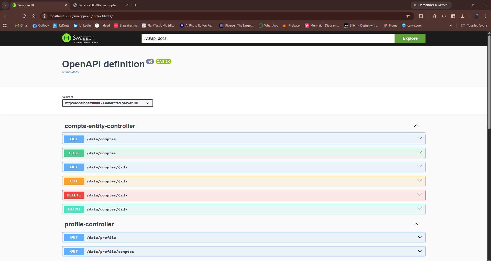
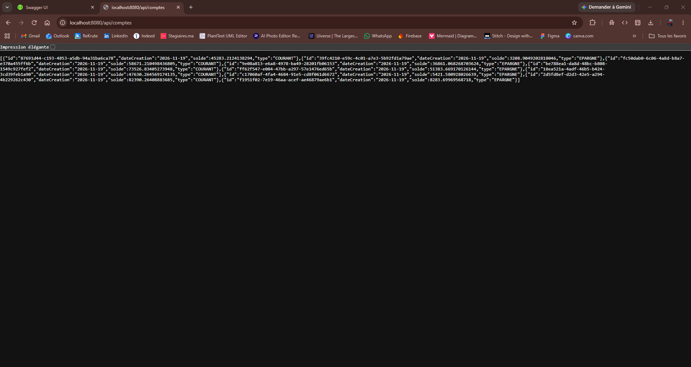
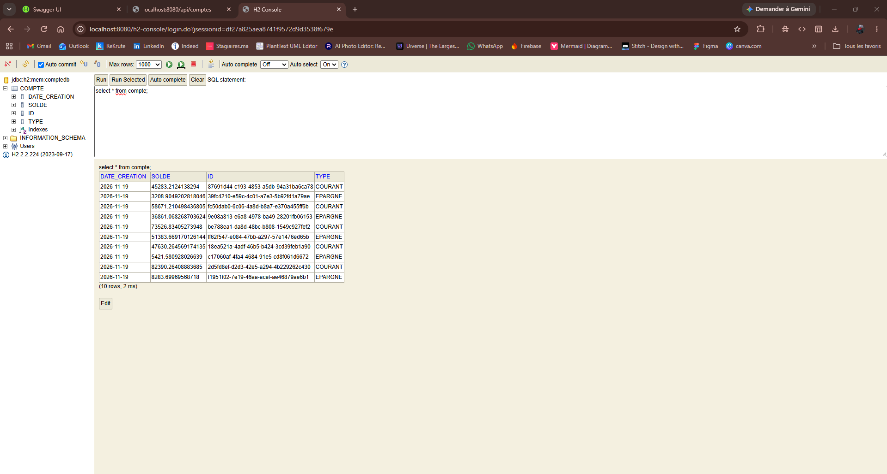
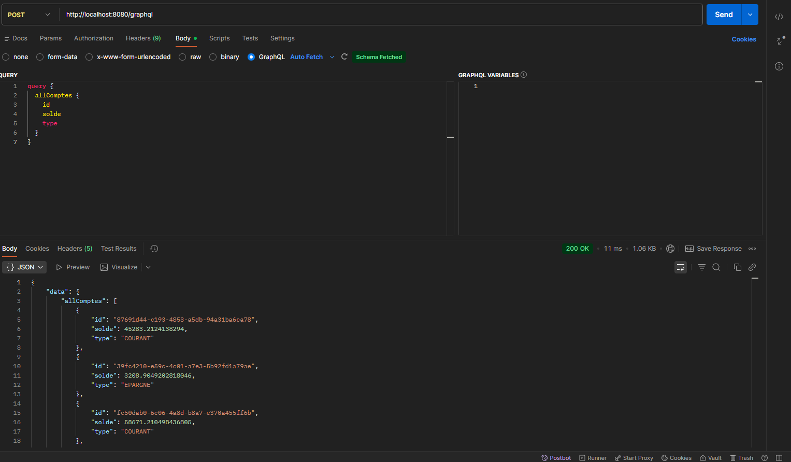

# TP1 — Développement d'une application Spring Boot

Application de gestion de comptes bancaires développée avec **Spring Boot**, intégrant une API REST, GraphQL, Spring Data JPA et une base de données H2.

## 1. Présentation du projet

Ce projet a été réalisé dans le cadre du TP1 de développement Java et Spring Boot.

L'objectif est de découvrir les principales fonctionnalités de Spring Boot à travers une application de gestion de comptes bancaires.

Le projet permet de manipuler des comptes bancaires à l'aide de deux interfaces : **REST API** et **GraphQL**.

## 2. Technologies utilisées

| Technologie | Utilisation |
|---|---|
| Java 17 | Langage de programmation |
| Spring Boot | Framework backend |
| Spring Web | Développement des API REST |
| Spring Data JPA | Gestion de la persistance |
| Spring GraphQL | Requêtes et mutations GraphQL |
| H2 Database | Base de données en mémoire |
| Swagger / OpenAPI | Documentation des API REST |
| Maven | Gestion des dépendances et compilation |
| IntelliJ IDEA | Environnement de développement |

## 3. Architecture du projet

L'application utilise une architecture en couches permettant de séparer les responsabilités.

```text
        Client REST / GraphQL
                 |
                 v
        Spring Boot Application
                 |
       +---------+---------+
       |                   |
       v                   v
 REST Controller    GraphQL Controller
       |                   |
       +---------+---------+
                 |
                 v
          Repository JPA
                 |
                 v
            H2 Database
```

Cette architecture facilite l'organisation du code, la maintenance et l'évolution de l'application.

## 4. Fonctionnalités

- Création de comptes bancaires
- Consultation de la liste des comptes
- Recherche d'un compte par identifiant
- Modification des informations d'un compte
- Suppression d'un compte
- Exposition des fonctionnalités via une API REST
- Exécution de requêtes et mutations GraphQL
- Documentation des endpoints avec Swagger
- Persistance des données avec Spring Data JPA et H2

Chaque compte bancaire possède notamment un identifiant, un solde et un type (`COURANT` ou `EPARGNE`).

## 5. Installation et exécution

### Prérequis

- JDK 17
- Maven ou Maven Wrapper
- IntelliJ IDEA ou un autre IDE Java
- Postman pour tester les API

### Cloner le dépôt

```bash
git clone https://github.com/mohamed-yawina/TP1-SpringBoot-CompteService.git
cd TP1-SpringBoot-CompteService
```

### Démarrer l'application

Sous Windows :

```powershell
.\mvnw.cmd spring-boot:run
```

L'application démarre sur le port **8080**.

## 6. Configuration

Le fichier `application.properties` contient les principaux paramètres suivants :

```properties
spring.application.name=compte-service
server.port=8080

spring.datasource.url=jdbc:h2:mem:comptedb
spring.datasource.driver-class-name=org.h2.Driver
spring.datasource.username=sa
spring.datasource.password=

spring.jpa.hibernate.ddl-auto=create

spring.h2.console.enabled=true
spring.h2.console.path=/h2-console

springdoc.swagger-ui.path=/swagger-ui.html

spring.graphql.path=/graphql
spring.graphql.graphiql.enabled=true
spring.graphql.graphiql.path=/graphiql
```

La base H2 fonctionne en mémoire : les données peuvent être réinitialisées au redémarrage de l'application.

## 7. Test de l'API REST

L'API REST permet d'effectuer les opérations CRUD sur les comptes bancaires.

| Méthode | Endpoint | Description |
|---|---|---|
| GET | `/api/comptes` | Consulter tous les comptes |
| GET | `/api/comptes/{id}` | Consulter un compte par ID |
| POST | `/api/comptes` | Ajouter un compte |
| PUT | `/api/comptes/{id}` | Modifier un compte |
| DELETE | `/api/comptes/{id}` | Supprimer un compte |

### Documentation Swagger

Accès à Swagger UI :

http://localhost:8080/swagger-ui.html



### Résultat du test REST

Exemple d'accès à la liste des comptes :

http://localhost:8080/api/comptes



## 8. Base de données H2

L'application utilise H2 pour stocker les données des comptes bancaires pendant son exécution.

Console H2 :

http://localhost:8080/h2-console

Paramètres de connexion :

```text
JDBC URL : jdbc:h2:mem:comptedb
Username : sa
Password :
```

### Capture de la base de données



## 9. Test de GraphQL

GraphQL permet de récupérer uniquement les champs nécessaires et d'exécuter des opérations sur les comptes bancaires.

Endpoint :

```text
POST http://localhost:8080/graphql
```

### Exemple de requête GraphQL

```graphql
query {
  allComptes {
    id
    solde
    type
  }
}
```

Cette requête permet de récupérer la liste des comptes avec leurs identifiants, soldes et types.

### Exemple de mutation

```graphql
mutation {
  addCompte(solde: 5000.0, type: COURANT) {
    id
    solde
    type
  }
}
```

Cette mutation permet d'ajouter un nouveau compte bancaire.

### Test avec Postman

Les requêtes GraphQL peuvent être exécutées directement dans Postman en utilisant la méthode `POST`.



## 10. Résultats et bilan

Les tests réalisés permettent de présenter les principales fonctionnalités du projet :

- Documentation des API REST avec Swagger
- Consultation des comptes via REST
- Accès à la base de données H2
- Exécution d'une requête GraphQL avec Postman

Les captures d'écran fournissent une démonstration de ces fonctionnalités.

## 11. Objectifs pédagogiques

Ce TP a permis de :

- Comprendre le fonctionnement de Spring Boot
- Développer des API REST
- Appliquer une architecture en couches
- Utiliser Spring Data JPA
- Manipuler une base de données H2
- Découvrir GraphQL
- Tester les API avec Swagger et Postman

## 12. Auteur

**Mohamed Yawina**

Étudiant en dernière année d'ingénierie informatique à l'EMSI.

Projet réalisé dans le cadre des travaux pratiques de développement Java et Spring Boot.
